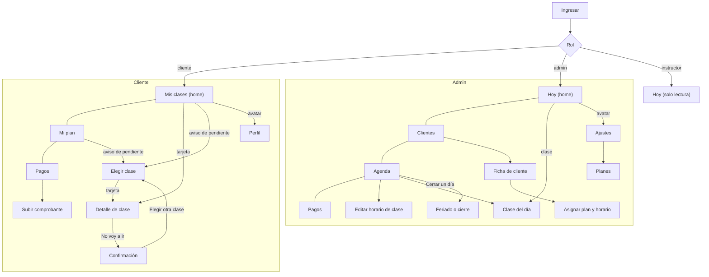

# Propuesta: horarios fijos

**Estado:** propuesta para revisar con Simon, 12 de noviembre de 2026. Todavía no cambia `PRD.md` ni `DESIGN.md`: se actualizan cuando esta propuesta quede cerrada.

## 1. El cambio de perspectiva

Lo que dijo Simon: la gente casi siempre va el mismo día y a la misma hora. No reserva semana a semana. Cuando alguien se da de alta en un plan (seguramente lo hace el admin), elige sus horarios y quedan para siempre. El modelo de fondo es el mismo, pero el sistema reserva solo según esa preferencia. Las clases pendientes aparecen cuando hay un feriado o cuando alguien pide recuperar una ausencia.

Consecuencias:

- **Reservar deja de ser la rutina y pasa a ser la excepción.** La rutina es "mis horarios fijos" y "mis próximas clases".
- **El cupo semanal ("Te queda 1 de 3 clases") desaparece como concepto del cliente.** Con horario fijo la semana siempre está completa. Lo único que puede quedar libre es una **clase pendiente**, y eso tiene su propio aviso.
- **Una sola regla para reservar a mano: reservar es usar una clase pendiente.** Sin clase pendiente no hay nada que reservar. Esto cubre feriados, recuperaciones y cambios puntuales ("esta semana voy el martes en vez del lunes" = cancelo el lunes a tiempo y uso esa pendiente el martes).
- **El admin pasa a tener más peso:** asigna planes y horarios, carga feriados y resuelve cupos.

Principios que se mantienen: consistencia y pocos casos especiales, mobile first, las páginas internas ocultan la barra y el avatar, y los estados nunca parecen botones.

## 2. Modelo de datos

Decisiones técnicas (ya tomadas; no hace falta que Simon las decida):

| Concepto | Qué es | Notas |
|---|---|---|
| **Horario de clase** (`class_slots`) | La clase recurrente: actividad, centro, día de la semana, hora, duración, instructor, cupo. | Es lo que hoy el PRD llama "horarios semanales recurrentes". Se queda. |
| **Clase del día** (`class_sessions`) | Una ocurrencia concreta de un horario en una fecha. Puede estar **suspendida** (feriado, cierre, instructor enfermo). | Se genera sola por adelantado. |
| **Horario fijo** (`standing_bookings`) | Persona + horario de clase + desde cuándo (y hasta cuándo, si se cambia). | **Nuevo.** Es la "preferencia por defecto". |
| **Reserva** (`bookings`) | Persona + clase del día, con origen `fija` o `pendiente` y estado `reservada`, `cancelada`, `cancelada tarde`, `suspendida`. | El modelo de reserva no cambia: el horario fijo solo las crea solo. |
| **Clase pendiente** (`makeup_credits`) | Un crédito para reservar una clase a mano: motivo (cancelación a tiempo, feriado, ausencia), actividad de origen, vencimiento, y la reserva en la que se usó. | **Nuevo.** Reemplaza "recuperación" y el saldo semanal. |
| **Cierre** (`closures`) | Fecha (o rango), centro o todos, motivo ("Feriado", "Cierre por mantenimiento"). | **Nuevo.** Suspende todas las clases del día en ese centro. |

### Reservas automáticas

- Un job diario (idempotente) genera las clases del día y las reservas de los horarios fijos con **4 semanas de anticipación**. También se corre al asignar o cambiar un horario fijo y al crear un cierre.
- Así cualquier clase de las próximas 4 semanas existe como reserva real: se puede ver, cancelar y contar en el cupo.
- Si un horario fijo cae en una fecha con cierre, la reserva se crea directamente como `suspendida` y genera una clase pendiente.

### Faltar una vez (cancelar una fecha)

- **Con 24 h o más:** la persona cancela esa fecha desde el detalle. La reserva pasa a `cancelada`, el lugar vuelve al cupo de esa fecha y se crea **una clase pendiente**. El horario fijo no se toca.
- **Con menos de 24 h:** igual que hoy, solo por WhatsApp y la carga el admin (`cancelada tarde`). Si da o no clase pendiente es una pregunta abierta (ver P3).
- **Ausencia sin avisar:** igual que hoy, la reserva cuenta como presente por defecto y el admin marca la ausencia.
- Si se cancela a tiempo una reserva hecha con una pendiente, la pendiente vuelve (con su vencimiento original). Si se cancela tarde, se pierde.

### Feriados y cierres

- El admin crea un cierre. Antes de confirmar ve el impacto ("Se suspenden 9 clases y 46 reservas; 46 personas reciben una clase pendiente").
- Cada reserva afectada pasa a `suspendida` y la persona recibe una clase pendiente con motivo "Feriado".
- Suspender una sola clase (por ejemplo, el instructor se enfermó) es el mismo mecanismo aplicado a una clase del día. No hay un caso especial.
- v1 sigue sin notificaciones proactivas (PRD §8): la persona lo ve en la app. Queda anotado que los feriados son el primer motivo fuerte para tener avisos por WhatsApp más adelante.

### Clases pendientes

- Se usan desde Reservar, en cualquier clase del día con lugar libre, dentro de las actividades permitidas y antes del vencimiento.
- Son **extra** a la semana: no hay saldo semanal que controlar, solo la cantidad de pendientes.
- Vencen (regla a definir, ver P1). Si el plan termina, vencen con él.
- Las genera el sistema (cancelación a tiempo, cierre) o el admin a mano ("Dar clase pendiente").

### Cupo

- El cupo de una clase del día = cupo del horario − reservas activas de esa fecha (fijas + pendientes).
- **Al asignar un horario fijo, el sistema no deja pasarse del cupo**: si ese horario ya tiene tantos fijos como cupo, aparece como "Completo" y no se puede elegir.
- Si alguien cancela una fecha, ese lugar queda libre **solo esa fecha** para quien use una pendiente.
- Si el admin baja el cupo de un horario por debajo de los fijos actuales, el sistema lo bloquea y muestra quiénes sobran. Tiene que mover a alguien primero. Sin lista de espera en v1.

### Cambiar el horario fijo y cambiar de plan

- Cambiar el horario fijo = cerrar el horario fijo actual en una fecha y abrir uno nuevo desde ahí. Las reservas automáticas futuras se regeneran; las pasadas no se tocan. Por defecto aplica desde el lunes siguiente.
- Cambiar de plan = asignar el plan nuevo y su horario fijo en el mismo paso. Las clases pendientes que ya tenía se mantienen hasta su vencimiento.
- Regla de consistencia: **la cantidad de horarios fijos es igual a las clases por semana del plan** (plan 3x = 3 horarios). El sistema no deja guardar menos ni más. Si en el horario que quiere la persona no hay lugar, el admin elige otro; no hay horarios "a medio asignar".
- Quién puede hacer estos cambios es una pregunta abierta (ver P2).

### Lo que se va del modelo actual

- El límite "clases por semana" deja de controlarse en cada reserva: lo garantiza el horario fijo.
- La "recuperación" como concepto separado se unifica en **clase pendiente**.
- El reinicio mensual de ausencias pierde sentido: lo reemplaza el vencimiento de cada pendiente.

## 3. Cliente

### Navegación

Se mantienen tres pestañas y el avatar, pero cambian los destinos:

| Antes | Ahora | Por qué |
|---|---|---|
| **Reservar** (home) | **Mis clases** (home) | Lo primero que importa es "cuándo es mi próxima clase", no reservar. |
| Mi plan | **Mi plan** | Se queda, con el horario fijo como centro. |
| Pagos | **Pagos** | Se queda igual. |
| Perfil (avatar) | Perfil (avatar) | Se queda igual. |

**Reservar deja de ser pestaña** y pasa a ser una página interna ("Elegir clase") que solo se abre desde el aviso de clase pendiente. Una pestaña que casi siempre estaría vacía o bloqueada es peor que una página que aparece cuando sirve.

### Mis clases (home, pestaña)

- **Se queda de Reservar:** las tarjetas de clase con foto que desborda, el chevron, las líneas de estado con ícono y la View Transition al detalle.
- **Cambia:** en vez de la agenda del día, muestra **tus próximas clases** (esta semana y la próxima), agrupadas por día. Todas las tarjetas se tocan igual y abren el detalle.
- **Aviso de clase pendiente:** solo cuando hay alguna. Es una línea de texto, sin cápsula de fondo ("Tenés 1 clase pendiente · vence el 30 de noviembre"), y lleva a "Elegir clase". El único botón posible es "Elegir clase", anclado abajo.
- **Clase suspendida por feriado:** la tarjeta sigue en la lista con la línea "Suspendida · Feriado" (estado, no botón) y aparece el aviso de pendiente.
- **Se va:** la tira de la semana con días "reservados" en verde, el banner "Te queda X de 3 clases" y el título "Clases del miércoles".

### Elegir clase (ex Reservar, página interna)

- Página interna: oculta la barra y el avatar, tiene volver.
- **Se queda:** la tira de días (limitada a los días hasta el vencimiento de la pendiente), las tarjetas y el detalle.
- **Cambia:** muestra solo las clases donde se puede usar la pendiente. Las que no son del plan no aparecen, para no sumar un estado que no sirve. Las completas sí aparecen, marcadas "Cupo completo", porque explican por qué no está esa hora.
- **Se va:** el banner semanal y el estado "No incluida en tu plan".

### Detalle de clase (página interna)

- **Se queda:** el layout, el encabezado que hereda la tarjeta, la View Transition, las líneas con ícono, una sola acción anclada abajo y la hoja de confirmación.
- **Cambia la acción según el estado:**

| Estado | Acción |
|---|---|
| Tu clase fija, con 24 h o más | "No voy a ir" (cancela solo esa fecha; la confirmación dice "Te queda una clase pendiente hasta el 30/11") |
| Tu clase fija, con menos de 24 h | Sin botón; línea con el WhatsApp desde Perfil (como hoy) |
| Recién cancelada | Aviso "Listo, no vas el lunes 16. Tenés 1 clase pendiente" con Deshacer, y botón "Elegir otra clase" |
| Abierta desde Elegir clase, con lugar | "Usar clase pendiente" |
| Cupo completo | Sin botón, explicación |
| Suspendida (feriado) | Sin botón, explicación ("No hay clase por el feriado. Te dimos una clase pendiente.") |
| Pasada | Sin botón; "Fuiste" o "Ausente" como línea |

- **Se va:** el estado "No incluida en tu plan".

### Mi plan (pestaña)

- **Se queda del PR #5:** las secciones con título y líneas con ícono, todo información, sin chips ni tarjetas que parezcan botones.
- **Cambia:** el centro es **Tu horario**: una línea por horario fijo ("Lunes 18:00 · Pilates · Mendoza"). Después: Tu plan (nombre, clases por semana, actividades, renovación mensual) y Clases pendientes (cantidad y vencimiento), solo si hay.
- **Se va:** "Esta semana" con el saldo, y la cápsula "Te queda 1 de 3 clases".
- **Sin plan:** explicación y un único botón "Escribir a Kinaf por WhatsApp" (el mismo canal que la cancelación tardía en Perfil).
- **Sin precio ni cambio de plan:** el monto se ve en Pagos y el cambio de plan lo hace el admin (salvo que Simon decida otra cosa en P2).

### Pagos y Perfil

- Sin cambios de fondo. Pagos depende de la respuesta a P5 (qué pasa si no paga).

## 4. Admin

El admin sigue siendo un teléfono con la gramática Píldora (DESIGN.md §11). Propuesta de pestañas: **Hoy, Clientes, Agenda, Pagos**, y el avatar abre Ajustes (Planes, Perfil del centro).

| Pantalla | Qué hace |
|---|---|
| **Hoy** (home) | Clases de hoy con asistentes; marcar ausencia. Avisos: comprobantes en revisión, conflictos de cupo, personas sin horario asignado. Responde en parte la pregunta abierta "qué muestra el inicio del admin". |
| **Clientes** | Lista con buscador. |
| **Ficha de cliente** (interna) | Plan, horario fijo, próximas clases, clases pendientes, pagos. Una acción principal según el caso ("Asignar plan" si no tiene). Acciones secundarias: cambiar horario, dar clase pendiente, cancelar una fecha tarde. |
| **Asignar plan y horario** (interna, en pasos) | 1) Elegir plan. 2) Elegir tantos horarios como clases por semana, filtrados por las actividades del plan, con lugar libre por horario; los completos no se pueden elegir. 3) Desde qué fecha. 4) Confirmar. El mismo flujo sirve para alta, cambio de horario y cambio de plan. |
| **Agenda** | Grilla semanal de horarios de clase con ocupación fija ("8 de 10 fijos"). Crear o editar un horario. Acción "Cerrar un día" para feriados. |
| **Clase del día** (interna) | Asistentes de esa fecha, quién usa pendiente, "Suspender esta clase". |
| **Feriado o cierre** (interna) | Fecha, centros, motivo, impacto antes de confirmar. Lista de cierres próximos. |
| **Pagos** | Como en el PRD: en revisión, registrar pago, forzar pagado, historial. |
| **Planes** (Ajustes) | Crear y editar planes: clases por semana, actividades permitidas, precio. |

**Instructor:** la misma pantalla Hoy, solo lectura.

## 5. Qué pasa con los diseños existentes

- **PR #3 (Reservar y detalle, mergeado):** se queda en `main` como base visual. Se reutilizan tarjeta, líneas de estado, chevron, View Transition, detalle y hoja de confirmación. Reservar se convierte en "Elegir clase" y nace "Mis clases"; esos mockups se reemplazan en el prototipo conjunto. No hace falta revertir nada.
- **PR #5 (Mi plan, abierto):** **recomiendo cerrarlo sin mergear** y llevar al prototipo conjunto lo que funcionó: las secciones con líneas con ícono y el saldo como texto sin cápsula. Su contenido principal ("Esta semana" con saldo) queda obsoleto con el horario fijo. La rama queda como referencia.
- **DESIGN.md:** cuando se cierre esta propuesta, la sección "Banner de plan / avisos" pasa a "Aviso de texto, sin cápsula" y se agrega el mapa de navegación nuevo.
- **PRD.md:** se reescriben las secciones 1 a 4 y las preguntas abiertas con lo que se decida acá.

## 6. Prototipo conjunto

Después de esta propuesta, todas las pantallas que faltan (cliente y admin) se diseñan juntas como **un solo prototipo navegable**, con la misma persona y la misma semana de ejemplo, en vez de pantalla por pantalla. Los gates se corren sobre cada pantalla del prototipo.

### Pantallas y estados que tiene que cubrir

**Cliente**

| Pantalla | Tipo | Estados |
|---|---|---|
| Ingresar | Pública | Normal, error |
| Mis clases | Pestaña (home) | Normal; con clase pendiente; con clase suspendida por feriado; sin plan; plan sin horario asignado todavía; (según P5) cuota vencida |
| Detalle de clase | Interna | Fija ≥ 24 h; fija < 24 h; confirmación de "No voy a ir"; recién cancelada; para usar pendiente; recién reservada con pendiente; cupo completo; suspendida; pasada (fuiste / ausente) |
| Elegir clase | Interna | Lista del día; día sin clases; un horario completo |
| Mi plan | Pestaña | Plan libre; plan de actividades específicas; con clases pendientes; sin plan |
| Pagos | Pestaña | Pendiente; en revisión; pagado; no pagado |
| Subir comprobante | Interna | Elegir archivo; enviado |
| Perfil | Interna (avatar) | Datos, WhatsApp, cerrar sesión |

**Admin**

| Pantalla | Tipo | Estados |
|---|---|---|
| Hoy | Pestaña (home) | Con clases; con avisos; día cerrado |
| Clientes | Pestaña | Lista; búsqueda sin resultados |
| Ficha de cliente | Interna | Activo; sin plan; con pendientes |
| Asignar plan y horario | Interna (pasos) | Elegir plan; elegir horarios (con uno completo); fecha; confirmar |
| Agenda | Pestaña | Semana; con un cierre |
| Editar horario de clase | Interna | Nuevo; editar; bajar cupo por debajo de los fijos (bloqueado) |
| Clase del día | Interna | Normal; suspender (confirmación) |
| Feriado o cierre | Interna | Formulario; impacto antes de confirmar |
| Pagos | Pestaña | En revisión; registrar pago |
| Planes | Interna (Ajustes) | Lista; editar |

**Instructor:** Hoy en solo lectura.

### Mapa de navegación

Las líneas `---` unen pestañas del mismo nivel; las flechas abren páginas internas (sin barra ni avatar). Ninguna pantalla queda a más de tres niveles de una pestaña.

## 7. Preguntas abiertas del round de Mi plan

| Pregunta | Estado |
|---|---|
| Cápsula o texto para "Te queda X clases" | **Resuelta:** el saldo semanal desaparece. Lo que queda es el aviso de clase pendiente, como texto sin fondo. |
| Planes de actividades específicas con cantidades fijas (2 Pilates + 1 Yoga) | **Cambia:** con horario fijo, la mezcla la define el horario elegido. Queda como P4. |
| Reglas de recuperación | **Se unifica** en clase pendiente. Queda como P1 y P3. |
| Canal cuando no hay plan | **Resuelta:** WhatsApp, el mismo canal que la cancelación tardía. |
| Cuota sin pagar | **Sigue abierta y pesa más**, porque el sistema reserva solo. Queda como P5. |
| Precio y cambio de plan en Mi plan | **Resuelta:** el precio se ve en Pagos y el cambio lo hace el admin (salvo P2). |
| Tocar las clases reservadas abre el detalle | **Resuelta:** sí, todas las tarjetas de clase abren el detalle. |

Del PRD: "cuándo aplica un cambio de plan" pasa a P2; "qué muestra el inicio del admin" queda con una primera propuesta (§4); "Kinesiología como actividad" sigue abierta, no la cambia este pivot; la pregunta 4 (yoga solo los lunes) se responde con P1.

## 8. Preguntas para Simon (por prioridad)

**P1. Clase pendiente: dónde se puede usar y cuándo vence.**
Cuando alguien cancela a tiempo o hay un feriado, recibe una clase pendiente. Hay que decidir: a) si se puede usar en cualquier actividad de su plan o solo en la misma que perdió (por ejemplo, perdió Yoga del lunes: ¿puede recuperar en Pilates?), y b) cuándo vence: a fin del mes de facturación (lo que dice hoy el PRD para recuperaciones; pero si el feriado es el 30, le queda un día), a los 30 días, o al fin del mes siguiente.
*Recomendación:* cualquier actividad de su plan (con un plan libre, cualquiera) y vencimiento a los 30 días de la clase perdida.

**P2. Quién arma y cambia el horario fijo.**
a) Solo el admin, y la persona le pide los cambios por WhatsApp; b) la persona también lo puede cambiar desde Mi plan, eligiendo entre los horarios con lugar. En los dos casos el cambio aplica desde el lunes siguiente. Lo mismo para cambiar de plan.
*Recomendación:* solo el admin en v1. Es raro que cambie, lo hace en el alta y evita que alguien se quede con el lugar de otro sin hablarlo.

**P3. Cancelación tardía y ausencias: ¿dan clase pendiente?**
Hoy el PRD dice que la ausencia habilita una recuperación, pero la cancelación tardía no. Eso es raro: el que no avisa recupera y el que avisa tarde no. Opciones: a) ninguna de las dos da pendiente; b) las dos dan; c) ninguna da automáticamente, y el admin puede dar una a mano cuando la persona lo pide ("pide recuperar por ausencia").
*Recomendación:* c). Automático solo para cancelar a tiempo y feriados; el resto lo decide el admin con un botón "Dar clase pendiente".

**P4. Planes de actividades específicas.**
Con horario fijo, ¿el plan tiene que fijar cuántas de cada actividad (por ejemplo "2 Pilates + 1 Yoga") o alcanza con "3 por semana entre Pilates y Yoga" y la mezcla sale de los horarios que se eligen?
*Recomendación:* la segunda. El plan es clases por semana + actividades permitidas + precio, y el horario fijo concreta la mezcla. Un concepto menos.

**P5. Si no paga la cuota.**
Como el sistema reserva solo, hay que decidir qué pasa si el día 11 la cuota sigue sin pagar: a) todo sigue igual y solo se ve "No pagado" en Pagos y en el admin; b) se suspenden las reservas automáticas hasta que pague (su lugar queda libre); c) el admin decide por persona con "Pausar plan" (que también sirve para vacaciones).
*Recomendación:* a) más c): nada automático, y el admin puede pausar un plan a mano. Pausar suspende las reservas de esas semanas sin dar clases pendientes.

**P6. Vacaciones o ausencias largas.**
Si alguien se va dos semanas, ¿cancela clase por clase (y junta pendientes que después no va a poder usar) o el admin pausa el plan esas semanas? ¿Se cobra igual el mes?
*Recomendación:* el admin pausa el plan (el mismo "Pausar plan" de P5). Las semanas pausadas no generan pendientes. El cobro sigue igual salvo que el admin lo ajuste en Pagos.
